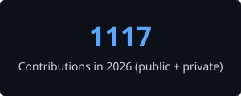

  

  
  
  
  

### 👨🏻‍💻 About Me

- 💼 Front End Developer who builds innovative, beautiful websites and web apps.
- 💬 Ask me about front-end development, React, React Native, and TypeScript.
- ⚡ Fun fact: I'm always learning new tech and pushing the boundaries of the web!

### 🚀 Featured Projects

<table>
  <tr>
    <td width="33%" valign="top">
      
      <h4><a href="https://app.safegeeg.com">SafeGeeg</a></h4>
      An escrow-backed freelance marketplace for hiring talent and paying across borders.  
      <code>Next.js</code> <code>React</code> <code>TypeScript</code>
    </td>
    <td width="33%" valign="top">
      
      <h4><a href="https://sitelytics.app/">Sitelytics</a></h4>
      AI-powered website auditing on web and mobile. I built the audit experience and the React Native auth and profile screens.  
      <code>Next.js</code> <code>React Native</code> <code>Lighthouse API</code>
    </td>
    <td width="33%" valign="top">
      
      <h4><a href="https://www.treasuryplot.com/">Treasury Plot</a></h4>
      A financial media and research platform with daily market briefings for investors and young professionals.  
      <code>Next.js</code> <code>Convex</code> <code>TailwindCSS</code>
    </td>
  </tr>
</table>

<a href="https://vixs.netlify.app/#work">See more on my portfolio →</a>

### 🛠 Tech Stack

**Frontend** 

**Backend & Data** 

**Tools** 

### 📊 GitHub Stats

  
  

  
  

